# Büşra Kaya
### Software Engineer | Artificial Intelligence & Software Development

Ankara, Türkiye

[LinkedIn](https://www.linkedin.com/in/büşra-kaya-41aa2b264/) · [GitHub](https://github.com/busra-kayaa)

---

## About

Software Engineering graduate from Konya Technical University. Interested in artificial intelligence, machine learning, and software development. Experienced in developing AI-powered applications, working with Large Language Models (LLMs), and building practical software solutions. Passionate about continuous learning, research, and applying technology to solve real-world problems.

---

## Professional Experience

**TRT — Long-Term Software Engineering Intern**
*February 2026 – May 2026*
- Worked on LLM-based applications and AI-powered text processing systems.
- Contributed to conversational data analysis and intent-related workflows.
- Developed text normalization solutions using local language models.

**Torku — SAP ABAP Intern**
*June 2025 – July 2025*
- Gained practical experience in SAP ABAP development.
- Participated in SAP and WMS integration processes.
- Supported integration testing and system workflows.

---

## Technical Expertise

**Programming Languages**

  
  
  
  
  
  

**Artificial Intelligence & Data Science**

  
  
  
  
  

**Frameworks & Development**

  
  
  

**Databases & Tools**

  
  
  
  
  
  
  

---

## Featured Projects

**Mizan — LLM-Based Text Normalization**
- Developed a text normalization system using local LLMs.
- Integrated FastAPI and React for application development.
- Worked with Llama-based models and rule-based correction methods.

**Smart Refrigerator Assistant**
- Developed a mobile application to reduce food waste.
- Implemented food recognition using MobileNetV2 and PyTorch.
- Integrated Firebase for authentication, database, and storage.
- Added expiry tracking, storage recommendations, and recipe suggestions.

---

## GitHub Statistics

  
  

